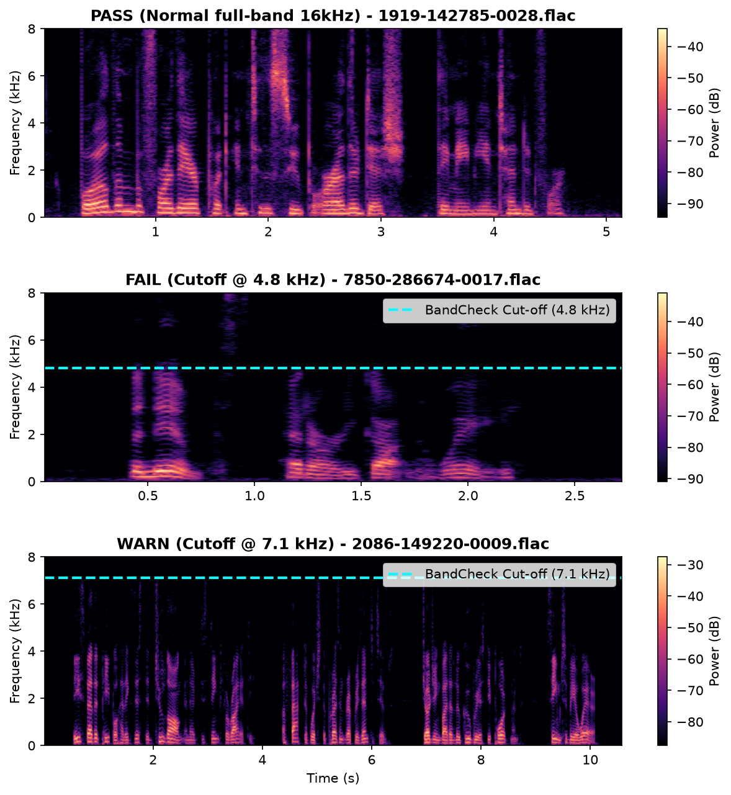

# bandcheck

**Find audio files whose real frequency range is lower than their sample rate claims.**

A file saved as "48 kHz WAV" may hold audio that was recorded at 16 kHz and upsampled, or that went through an MP3 or AAC encoder before being converted back. Everything above the source's limit is empty. A header never shows this. bandcheck measures where the sound really stops and tells you which files hold much less than they claim.

> **Status: alpha (0.1.0a1).** Tested on generated audio and real speech recordings (LibriSpeech dev-clean). Run `scripts/real_data_check.py` (see `docs/REAL_DATA_CHECK.md`) on your own data.

## Install

```bash
pip install --pre bandcheck      # after it is published; until then: pip install -e ".[dev]"
```
Needs Python 3.9+. Depends only on numpy, scipy, soundfile.

## Use

```bash
bandcheck check my_dataset/                        # every audio file in the folder
bandcheck check clip.wav
bandcheck check my_dataset/ --need-hz 8000 --out verdicts.csv
```
Options: `--need-hz N` (fail files whose sound stops below N Hz, e.g. 8000 for a 16 kHz speech model), `--show-pass`, `--jobs 4`, `--out file.csv`.
The report ends with a table by sample rate (files, how many are flagged, median cut-off), so you see at once that, for example, one rate holds most of the problem files.

## What the verdicts mean

| verdict | meaning | exit code |
|---|---|---|
| PASS | no sharp cut-off, or the sound reaches at least 90% of the way to the Nyquist frequency (or 19.5 kHz) | 0 |
| WARN | sound stops at 60-90% of the way to Nyquist. Typical of an MP3/AAC lowpass or a source one step lower in rate | 0 |
| FAIL | sound stops below 60% of the way, or below the `--need-hz` you asked for. Typical of upsampled audio | 1 |
| REVIEW | too short, silent, or too few loud parts to measure | 0 |
| ERROR | file could not be read | 0 |

For WARN and FAIL it lists the likely causes, for example `upsampled from 16000 Hz or a lossy encoder's lowpass (MP3/AAC)`. One cut-off frequency cannot tell an upsampled file from a lossy encode, so every candidate is listed and you decide.

## How it works (short)
1. Reads the file at its own sample rate (no resampling) and averages the channels.
2. Averages the power spectrum over the loud parts (frames within 30 dB of the loudest).
3. Looks for the sharpest drop in that average: the level just below a frequency compared with the level just above it. A drop of 25 dB or more, with nothing coming back above it, counts as a cut-off. The cut-off is reported where the level has fallen 10 dB.
4. Compares the cut-off with the Nyquist frequency of the file.

## What has been measured

### 1. Real Speech Audio (LibriSpeech dev-clean, 200 files)
- **Original recordings:**
  - 185 PASS, 11 WARN, 1 FAIL, 3 REVIEW, 0 ERROR.
  - Flagged files exhibited genuine hardware or codec lowpass cut-offs (e.g. 4.8 kHz cut-off on `7850-286674-0017.flac`, 7.0–7.1 kHz on audiobook recordings).
- **Planted upsampling test (185 files evaluated):**
  - From 8 kHz: 185 / 185 flagged as FAIL (median detected cut-off ratio: 1.03).
  - From 11.025 kHz: 185 / 185 flagged as WARN (median detected cut-off ratio: 1.05).
  - Detected cut-off sat within 3–5% of the source Nyquist frequency (consistent with resampling anti-aliasing filter transition).



### 2. Synthetic Audio & Bug Injection
- Full-band audio at 16, 22.05, 44.1 and 48 kHz: no cut-off found, PASS.
- Audio lowpassed at 16, 19 and 20 kHz (44.1 and 48 kHz files) and 6-7 kHz (16 kHz files): cut-off found within 2% of where it was put.
- Audio upsampled from 8, 11.025, 16, 22.05 and 24 kHz: flagged every time; the cut-off sits about 4-11% above the source's Nyquist frequency, because resampler filters roll off a little past it.
- MP3 copies made with ffmpeg (mono): 64 kbps gave a cut-off near 16.6 kHz (WARN); 128, 192 and 256 kbps gave about 20.1 kHz (PASS).
- 79 tests pass. 25 deliberately planted bugs in the code were each caught by the tests (5 needed a stronger test first).

## Limits (read these)
- **Defaults and thresholds:** The 25 dB drop, the 90% and 60% limits and the 19.5 kHz rule are engineering thresholds measured against generated audio and verified on LibriSpeech.
- **Cannot tell upsampled from lossy-encoded** from one number, and cannot tell either from a recording that really was made with a limited microphone or filter. It reports where the sound stops, not why.
- **Gradual roll-offs are not detected.** A gentle filter with no sharp edge, or dull-sounding music, passes.
- **Cut-offs below about 2 kHz are not looked for.** Speech and music change a lot there.
- A quiet recording or one with long silences is judged on its louder parts only.
- The channels are averaged, so a file with one full-band channel and one band-limited channel passes.
- It tells you the bandwidth, not whether the audio is good.

## Licence
MIT.
